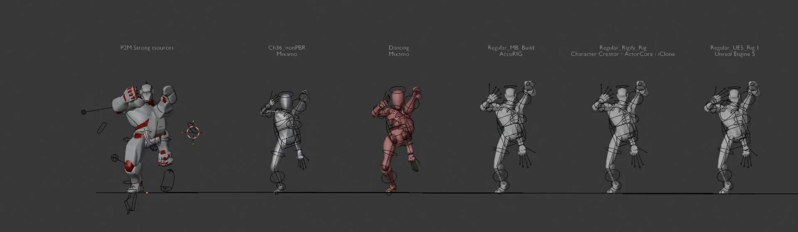
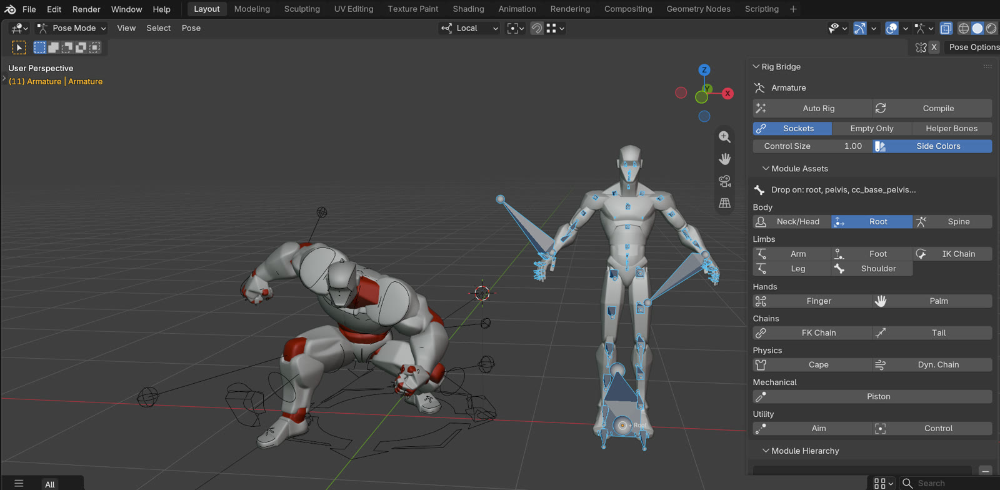
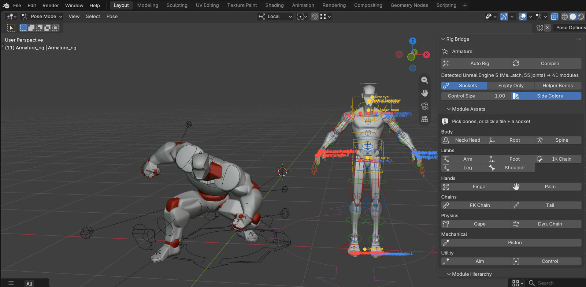
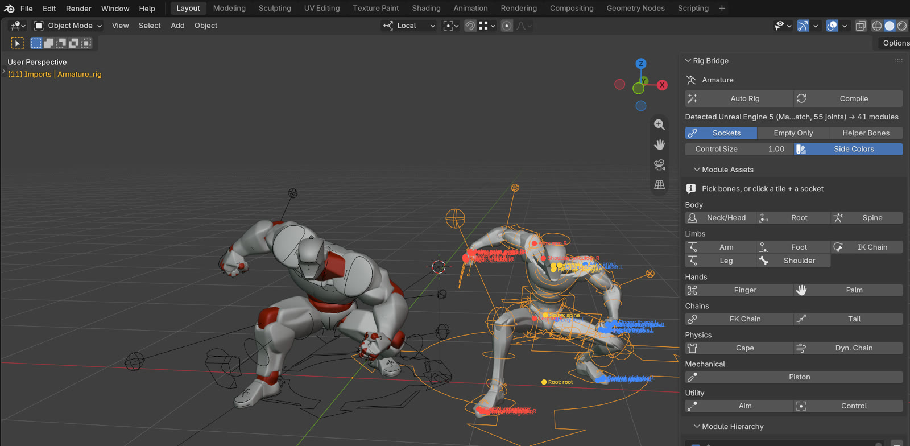

# Rig Bridge

**One-click modular control rigs for Blender: Mixamo, Unreal, Daz, Character Creator and 16 more skeleton standards.**

[**Download the latest release**](https://github.com/MondRubberduck/Rig-Bridge/releases/latest) · [**Project page**](https://mondrubberduck.github.io/Rig-Bridge/) · Companion retargeter: [Bulletproof Retarget](https://github.com/MondRubberduck/Bulletproof-Retarget)



A Blender add-on (4.2+, tested on 5.2.3) that works like a **modular control rig**, modelled on Unreal Engine's Modular Control Rig. Drop modules onto the sockets of any skeleton, click **Compile**, and you get a control rig that drives the original bones without changing them. Humanoids from **20 skeleton standards** are recognised automatically (Mixamo, UE4/UE5/UEFN/MetaHuman, Character Creator/ActorCore/AccuRIG, Daz G3/G8/G9, VRoid, VRM/Unity, Rigify/ARP exports, HumanIK, OptiTrack, CMU, Biped, VRChat, MMD, RenderPeople). Tails, hair, capes, pistons, eyes and tentacles have their own modules.

```
Skeleton ── sockets ──▶ modules (lego pieces) ──Compile──▶ control rig ──BIND- helpers──▶ original bones
                                                    ├─ Rigify backend: spine, neck/head, arm, leg, finger, palm…
                                                    └─ native backend: Tail, Dyn. Chain, Cape, Piston, Aim, IK/FK Chain, Control
```

## Import → Compile → Retarget: three clicks per character

| 1. Import | 2. Compile | 3. Retarget (with Bulletproof Retarget) |
|---|---|---|
|  |  |  |
| *File ▸ Import ▸ FBX*. The armature is already active, and the sockets show the suggested modules. | **Compile**. The skeleton standard is detected and the modules are placed and built. | *Target* = the character or its control rig, then **Retarget Animation**. The result is baked onto the rig's FK/IK controls. |

### Tested on real characters
A P2M source animation, retargeted onto five imported FBX characters through their Rig Bridge control rigs:

| Character | Detected as | Modules | Max. error vs. plain retarget |
|---|---|---|---|
| Ch36_nonPBR.fbx | Mixamo | 18 | 0.03 cm, 0.000° |
| Dancing.fbx | Mixamo | 18 | 0.10 cm, 0.000° |
| Regular_MB_Build.fbx | AccuRIG (MotionBuilder) | 33 | 0.10 cm, 0.000° |
| Regular_Rigify_Rig.fbx | Character Creator / ActorCore | 33 | 0.10 cm, 0.000° |
| Regular_UE5_Rig.fbx | Unreal Engine 5 | 41 | 0.09 cm, 0.000° |

Errors are measured with the skeleton's own animation removed, so only the control rig moves it.
The automated suites pass 39/39, 52/52 and 142/142 checks (see *Tests*).

## Install
1. Download `rig_bridge-<version>.zip` from [Releases](https://github.com/MondRubberduck/Rig-Bridge/releases/latest).
2. Drag it into Blender (4.2+, tested on 5.2.3), or use *Edit ▸ Preferences ▸ Get Extensions ▸ ⌄ ▸ Install from Disk…*.
3. Open *3D View ▸ Sidebar (N) ▸ Rig Bridge*. Rigify, which ships with Blender, is enabled automatically.

For retargeting, also install [Bulletproof Retarget](https://github.com/MondRubberduck/Bulletproof-Retarget/releases/latest) 1.3.2 or newer. The two add-ons are independent: Rig Bridge does rigging, Bulletproof Retarget does retargeting.

## Workflow (3D View ▸ Sidebar ▸ *Rig Bridge*, skeleton in Pose Mode)
| Unreal Modular Control Rig | Rig Bridge |
|---|---|
| Module Assets panel (drag a module) | **Module Assets** tiles, grouped by category. Click a tile with socket bones selected, or click a tile and then a socket ring in the viewport. |
| Sockets / schematic | Viewport overlay: a **ring** marks an empty socket and shows the suggested module. A **dot** marks a placed module (blue L, red R, yellow centre). |
| Connectors + auto-resolve | Each module has connectors (Start / End, Cylinder / Rod, Chains[] …). They fill themselves when dropped: the leg finds its toe, the piston finds its rod, the cape collects sibling chains, the aim finds the eye pair. You can override any of them in **Details**. |
| Module Hierarchy, Mirror, Duplicate | **Module Hierarchy** tree, with **Mirror** (L↔R), **Duplicate** and **Remove** |
| Auto-rig / Paste | **Auto Rig** fills every socket with its suggestion, repeating until nothing is left |
| Compile | **Compile**. Run it again at any time and the rig is rebuilt in place, keeping its animation. |
| Bake to Control Rig | **Bake to Control Rig**: FK Arms + IK Legs (default), Full IK or Full FK. FK *and* IK controls are keyed on every frame, so the IK/FK switch works anywhere in the clip. |
| Bake Animation Sequence | **Bake to Skeleton** (for FBX export or as a retarget source) |

The **Animate** section also has the **dynamics** blend slider (0 = pure keyframes, 1 = simulation) and *Make Collider*, which turns selected meshes into colliders for capes and hair. A mesh skinned to the skeleton gets a proxy driven by the rig, so there is no dependency cycle.

## Rig standards and retargeting (with Bulletproof Retarget)
Rig Bridge does **rigging only**. Retargeting is done by the separate add-on [Bulletproof Retarget](https://github.com/MondRubberduck/Bulletproof-Retarget). Rig Bridge never imports or requires it. Its skeleton standards are copied into `standards/standards.json` by `tools/import_bp_standards.py`, which reads a Bulletproof Retarget checkout without changing it, so both add-ons agree on what a skeleton is.

Detection order: your saved profiles → the standards table → built-in profiles → topology fallback. Control rigs (P2M, generated Rigify, Auto-Rig Pro) are recognised and left alone, so a second control rig is never stacked on top of one.

**Retarget onto a character (Unreal: retarget → Bake to Control Rig):**
1. Import the character, then click **Compile**. The imported armature is already active.
2. In Bulletproof Retarget (1.3.2+), set *Target* = the character or its control rig, then click **Retarget Animation**.
   It writes the animation onto the skeleton and runs **Bake to Control Rig**, so the animation lands on the controls.

Without Bulletproof Retarget 1.3.2, or with another retargeter:
1. Click **Release Skeleton**.
2. Retarget onto the skeleton.
3. Click **Bake to Control Rig**.

**Retarget from a character:** **Bake to Skeleton** first, then use the skeleton as the retarget *Source*.

## Modules
* **Rigify (body):** Root, Spine, Neck/Head, Shoulder, Arm, Leg (IK/FK, foot roll; *IK Stretch* is off by default so game skeletons keep their bone lengths), Finger, Palm, FK Bone, Tentacle.
* **Native (secondary and mechanical motion):**
  * **Control:** one animatable control.
  * **FK Chain**
  * **IK Chain:** IK with a pole and an IK_FK slider.
  * **Tail:** curl master, harmonic wave and optional dynamics.
  * **Dyn. Chain:** hair, ponytails, antennae; soft-body driven.
  * **Cape:** an array of chains simulated as cloth, with collision.
  * **Piston:** the cylinder and rod aim at each other, and the rod pivot stays on its parent.
  * **Aim:** look-at, with a pair plus a master target. Humanoid eyes get one automatically.
* The dynamics use Blender's own soft body and cloth, so the add-on isn't needed to render, and a render farm will play them back. Press Play from the first frame, or bake.

## Detection profiles (JSON) and custom modules (Python)
Profiles map names to modules. The built-in ones are `mixamo` and `unreal`, and you can save your own with *Save as Profile*. Custom modules go into the user `modules/` folder; open it with the folder button.
```python
from rig_bridge_api import Module, register_module
```
A starting point is in `examples/tail_module.py`. The profile format is: `{side}`, a `?` prefix for optional bones, `extends`, `strip_prefix`, per-part `settings` and a `parent` socket.

## Tests
```
blender -b --factory-startup --python tests/test_rig_bridge.py  -- <folder containing rig_bridge> out.blend   # detection, Rigify, transfer
blender -b --factory-startup --python tests/build_examples.py   -- <folder containing rig_bridge> examples.blend  # modular examples scene
blender -b --factory-startup --python tests/test_standards.py   -- <folder containing rig_bridge> out.blend [BP Retarget checkout]
blender -b --factory-startup --python tests/test_bp_interop.py  -- <folder containing rig_bridge> out.blend <BP Retarget checkout> <UE5 character.fbx>
```
* `build_examples.py` builds each example the way a user would (select sockets, click a tile, mirror, Auto Rig, Compile), animates it and measures zero rest drift, knee direction and foot roll, hair lag and settling, cape outside the body collider, tail wave, piston alignment and overlap, eyes on target, IK tip reach, rebuild keeping animation, and dynamics baking.
* `test_standards.py` builds a skeleton for every standard (from Bulletproof Retarget's own fixtures where they exist), keys a clip, compiles once, runs Bake to Control Rig in all three modes, then removes the skeleton's animation. The rig alone must reproduce the clip on every joint.
* `test_bp_interop.py` runs the full round trip with the real Bulletproof Retarget installed from its release zip: Mixamo mocap → UE5 character → Bake to Control Rig → Bake to Skeleton → Daz G8 → Daz control rig. Each step is compared with a plain, unrigged retarget.

## Changelog
* **0.4.1**
  * Straight limbs (Mixamo T-pose legs) are nudged by 0.1% instead of 2% for Rigify's pole. Mixamo knees no longer drift 2–3 cm once the leg bends.
  * Baked takes are named `<rig>|<action>`. Baking the same take again replaces it instead of adding `.001` copies.
  * Tested on the Tester set (Mixamo ×2, AccuRIG, CC, UE5, from a P2M source): 3 clicks per character, within 0.1 cm of a plain retarget.
* **0.4.0**
  * Bake to Control Rig keys Rigify's neck tweaks, so multi-bone necks (UE5, CC, Daz) are exact.
  * The eye Aim target follows the head.
  * Toe, jaw and tongue controls no longer pick up the torso pivot correction (it caused a 3–4 cm offset).
  * Verified on P2M_STRONG.blend: UE5, AccuRIG and CC skeletons, 22/22 checks.
* **0.3.0**
  * 20 skeleton standards, using Bulletproof Retarget's data, read-only.
  * Bake to Control Rig with FK / IK legs / full IK modes, plus exact IK poles.
  * Release Skeleton for retargeting onto a rigged character.
  * Spine roll and limb-socket fixes.
  * Eyes get an Aim module automatically.
* **0.2.0** Modular control rig in the style of Unreal: sockets, connectors, Auto Rig, native modules.
* **0.1.0** One-click Rigify rig for Mixamo and Unreal skeletons.

## Known limitations
* Not identical to Unreal. Unreal modules are Control Rig graphs, while these are Rigify rigs or Blender constraints. Unreal's per-module physics (Chain Dynamics/Spring) runs in the solver; here it is a soft body or cloth simulation that needs playback from frame 1 (or a bake) to scrub.
* No face rig. Eyes get Aim, the jaw a control and the tongue an FK chain.
* In IK, joint positions and the hand/foot/body pose are exact. The roll of the upper and lower arm/leg follows the rig's elbow/knee hinge. If the source animation twists the forearm, switch that limb to FK or use Full FK.
* Multi-bone necks (UE5 `neck_01/02`, CC `NeckTwist01/02`, Daz `neckLower/Upper`): Bake to Control Rig also keys Rigify's neck tweaks, so every neck bone is reproduced exactly. When you animate by hand, the neck control bends the whole neck and the tweaks adjust single bones.
* Humanoid eyes get an Aim module whose target rides on the head, so the eyes turn with the head.
* Twist and share bones are correctives: Rig Bridge drives them, while a plain retarget leaves them rigid. Expect the skin around the shoulders, elbows, knees and toes to differ from an un-rigged retarget. That is intended.
* Twist bones are driven like UE: the upper arm and thigh twist from the parent, the forearm and calf take a share of the hand/foot twist, set by each bone's position along the limb. CC "ShareBone" correctives take half the joint rotation. UE `ik_foot_*` / `ik_hand_*` bones follow the feet and hands, so exported animation keeps in-engine IK working.
* After Compile the game skeleton is hidden but stays bound. Use *Animate ▸ Skeleton ▸ Show* to see it.
* Rigify's rig UI script needs *Allow Execution* (standard Rigify behaviour).

## License
GPL-3.0-or-later. © Nils Gallist
